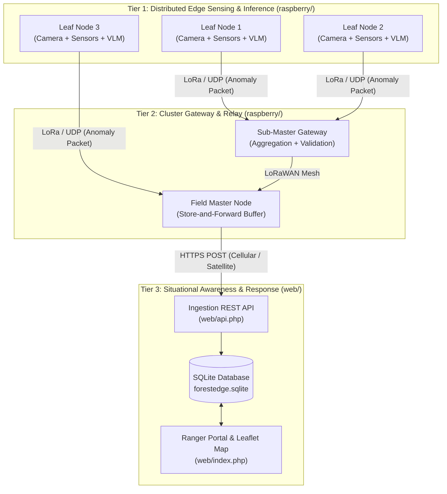

# ForestEdge: Autonomous IoT & Edge GenAI Forest Risk Monitoring Platform

[](LICENSE)
[](qemu/)
[](raspberry/)
[](qemu/)
[](#recognition--milestones)

**ForestEdge** is an autonomous IoT and Edge GenAI forest risk monitoring platform engineered for real-time environmental surveillance, wildfire detection, tree disease identification, and illegal logging prevention in off-grid, low-connectivity forest ecosystems.

Rather than streaming bandwidth-intensive high-resolution video streams or sensor feeds over fragile long-distance links to distant cloud data centers, ForestEdge pushes multimodal vision-language models (VLMs) and edge intelligence directly into the canopy. The distributed system leverages low-bandwidth **LoRa / LoRaWAN** telemetry meshes across field edge nodes, cluster sub-master aggregators, and resilient field gateways to achieve autonomous, near-zero-latency risk detection and response.

---

## Key System Pillars & Figures

* **Core Workload & Quantized Models**:
  Evaluates and deploys quantized vision-language and small language models in GGUF format—including `Qwen2-VL-2B-Instruct`, `Qwen3-VL-2B-Instruct`, `LLaVA`, `Llama-3.2-1B`, and `Qwen2.5` (0.5B–2B parameter range). Workloads are executed across resource-constrained edge runtimes (`llama.cpp`, `ggml`, and `IREE`/`MLIR`) with careful tuning of context windows, memory footprint, and low-power CPU instruction sets.
* **RISC-V & Systems Exploration**:
  Embedded Linux builds generated via Buildroot, system and user-mode emulation via QEMU (and Renode), and hardware-level vector acceleration. ForestEdge introduces a specialized **RVV 1.0 4-way unrolled microkernel** accelerating `MUL_MAT` dot products for `Q8_0` quantized weights, achieving up to **1.80× user-mode speedup** and a **43% median latency reduction** under QEMU evaluation.
* **Recognition & Milestones**:
  * **Incubation**: Incubated at **SSKIC-IoBM** (Shahjehan S. Karim Incubation Center).
  * **Ignite AI Wrapper Competition**: Placed **6th Regionally** for innovative edge intelligence.
  * **Industry Honors**: Named a **P@SHA ICT Awards 2026 Finalist** in the edge-sensing and conservation technology domain.
* **Open-Source Handover & Governance**:
  Prepared for public open-source stewardship and transfer to the **[MERL-UITU](https://github.com/MERL-UITU)** (Micro Electronics Research Laboratory - Usman Institute of Technology University) organization. All components adhere to strict repository hygiene, secret sanitization, and parameterized configuration standards.

---

## End-to-End System Architecture

ForestEdge operates as a three-layer edge-to-dashboard pipeline:



1. **Local Anomaly Filtering at the Edge**: Leaf nodes capture images and sensor data at regular intervals. If the local VLM infers `"nothing"` (healthy forest conditions), the data is discarded locally, eliminating 99%+ of unnecessary transmissions.
2. **Cluster Aggregation**: When an anomaly (`FIRE`, `DISEASE`, `LOGGING`, `PEST`) is detected, a compact JSON payload is forwarded via LoRa / LoRaWAN to a Sub-Master or Master Node.
3. **Resilient Field Gateway**: The Master Node manages field-to-cloud synchronization. If cellular or satellite uplinks fail, alerts are stored in a local persistent buffer (`alerts_buffer.json`) and flushed upon link restoration.
4. **Command & Incident Management**: The web dashboard provides real-time geospatial tracking (Leaflet.js), incident telemetry inspections, and structured operator acknowledgement workflows (`ACK` / `FALSE-EVENT`).

---

## Subdirectory Map & Execution Layers

The repository is organized into three distinct subdirectories mapping to the hardware, emulation, and application layers:

| Directory | Layer / Purpose | Key Technologies | Documentation |
| :--- | :--- | :--- | :--- |
| **[`qemu/`](qemu/)** | **Virtualized RISC-V Emulation & Acceleration**<br/>Virtual system testbed for testing RISC-V Vector (RVV 1.0) instructions, Buildroot Linux kernel boot, and precompiled quantized `llama.cpp` builds (`llama-bench`, `llama-cli`, `llama-mtmd-cli`). | `QEMU 64-bit`, `RVV 1.0`, `Buildroot`, `musl`, `ggml`, `GGUF` | [qemu/README.md](qemu/README.md) |
| **[`raspberry/`](raspberry/)** | **Edge Node Prototyping & Field Runtime**<br/>Python-based ForestEdge OS managing physical sensor drivers (I2C/smbus2), multi-fallback camera capture (OpenCV/CSI/libcamera), local VLM inference, multi-role orchestration (`LeafNode`, `SubMasterNode`, `MasterNode`), and LoRaWAN UART communication. | `Python 3.12`, `OpenCV`, `smbus2`, `pyserial`, `systemd` | [raspberry/README.md](raspberry/README.md) |
| **[`web/`](web/)** | **Central Monitoring Dashboard & Telemetry API**<br/>Operator portal for forest rangers and emergency teams, featuring real-time KPI metrics, Leaflet interactive cluster mapping, incident deep-dives, audit trail tracking, and token-authenticated ingestion API. | `PHP 8.1+`, `SQLite3`, `PDO`, `Leaflet.js`, `Vanilla CSS` | [web/README.md](web/README.md) |

---

## Quickstart & Local Setup

### 1. RISC-V Emulation Testbed (`qemu/`)

To boot the RISC-V 64-bit virtual machine with Vector 1.0 extensions:

```bash
cd qemu

# Set paths to your Buildroot images (or use defaults)
export BUILDROOT_DIR="$HOME/buildroot"
export VLEN=128
export SMP=4

# Run virtual machine in serial terminal mode
./qemu_run_Script.sh --serial-only
```

*Inside the guest OS, run the precompiled multimodal VLM runner:*
```bash
./llama.cpp_q8_build_rvv/bin/llama-mtmd-cli \
    -m /root/models/Qwen3VL-2B-Instruct-Q4_K_M.gguf \
    --mmproj /root/models/mmproj-Qwen3VL-2B-Instruct-Q8_0.gguf \
    --image /root/test_images/sample.jpg \
    -sys "You are an expert forest ranger. Analyze the image and return JSON." \
    -p "Identify if this image shows normal conditions or a risk event." \
    -t 4
```
For complete benchmark figures, microkernel details, and QEMU setup, see the [qemu/README.md](qemu/README.md).

---

### 2. Edge Hardware Runtime (`raspberry/`)

To deploy and execute ForestEdge OS on edge single-board computers:

```bash
cd raspberry

# Copy and configure the node parameters
cp config.json.template config.json

# Execute ForestEdge OS
python3 main.py config.json
```

To configure automatic startup on boot via systemd:
```bash
sudo cp forestedge.service /etc/systemd/system/
sudo systemctl daemon-reload
sudo systemctl enable --now forestedge.service
```
For hardware pinouts, sensor wiring, and LoRa transceiver instructions, see the [raspberry/README.md](raspberry/README.md).

---

### 3. Monitoring Dashboard & Ingestion Server (`web/`)

To launch the web dashboard and REST API locally:

```bash
cd web

# Start local development server
php -S 0.0.0.0:8000
```

1. Navigate to `http://localhost:8000/login.php` in your browser.
2. Sign in with the default development credentials:
   * **Email**: `admin@forestedge.local`
   * **Password**: `password`
3. Test ingestion via cURL:
   ```bash
   curl -X POST "http://localhost:8000/api.php?key=FE_SECRET_2026" \
     -H "Content-Type: application/json" \
     -d '{"type":"heartbeat","cluster_id":"01","node_id":"N01M01","status":"Healthy"}'
   ```
For API contracts, payload schemas, and database structure, see the [web/README.md](web/README.md).

---

## Repository Hygiene & MERL-UITU Handover Guidelines

Prior to publishing or transferring this repository to the **MERL-UITU** organization, contributors and automated agents must adhere to the following standards:

1. **Secret & Key Sanitization**:
   * Never commit production API keys, bearer tokens, or cloud credentials.
   * Configure `master_cloud_url` and API secrets using environment variables or untracked local `config.json` files.
2. **Path Parameterization**:
   * Do not commit hardcoded host machine paths (e.g., `/home/username/...` or `C:\Users\...`).
   * Scripts such as `qemu/qemu_run_Script.sh` must rely on environment variable defaults (`BUILDROOT_DIR`, `BUILDROOT_IMAGES`).
3. **Weight & Model Exclusions**:
   * Heavy GGUF binary model weights (`*.gguf`) must **not** be checked into version control. Download models onto edge devices or mount them via QEMU VirtIO drives.
4. **Licensing Compliance**:
   * The ForestEdge orchestration code, hardware HAL, and web dashboard are distributed under the **MIT License**.
   * Upstream dependencies bundled or evaluated (including `llama.cpp` and `ggml`) are governed by their respective open-source licenses (MIT).

---

## License

This project is licensed under the [MIT License](LICENSE).
See the individual component directories for third-party software notices.
